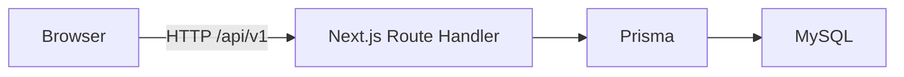

# API overview

## Status and architecture

The API is a separate Next.js App Router application in `backend/`. Route Handlers live below
`backend/src/app/api/`; the versioned API prefix is `/api/v1/`. The health endpoint and the User
Management reference endpoints have Route Handlers. Other resource directories do not represent
working endpoints.

The health handler queries Prisma directly. User Management demonstrates the route → validation →
service → repository → Prisma flow. See the [backend architecture](../architecture/backend-architecture.md).



In local development the backend listens on port 3001. The frontend API base URL is configured
with `NEXT_PUBLIC_API_URL`; see [environment setup](../development/environment-setup.md).

## Implemented endpoint

### `GET /api/v1/health`

| Item | Contract |
|---|---|
| Purpose | Check API availability and execute a read-only `SELECT 1` through Prisma |
| Authentication | Not required |
| Query/path parameters | None |
| Request body | None |
| Success | HTTP 200; JSON success envelope with `data.status = "ok"` and an ISO timestamp |
| Database failure | HTTP 503; JSON error envelope with message `Database unavailable` |

Successful response:

```json
{
  "success": true,
  "message": "Campus360 API is available",
  "data": {
    "status": "ok",
    "timestamp": "2026-01-01T00:00:00.000Z"
  },
  "meta": null
}
```

Database-unavailable response:

```json
{
  "success": false,
  "message": "Database unavailable",
  "data": null,
  "errors": [],
  "meta": null
}
```

The timestamp above is an example of the response shape, not a fixed value. The handler is
implemented in [`route.ts`](../../backend/src/app/api/v1/health/route.ts).

## User Management reference API

The implemented user endpoints and their authorization rules are documented in
[`users.md`](./users.md). They use the service/repository architecture and require an existing
authenticated session.

## Planned APIs

Authentication, departments, and courses have no API Route Handler implementations yet. Their
URL details, request schemas, and response contracts are **To Be Confirmed**. See the
[authentication](./authentication.md), [departments](./departments.md), and [courses](./courses.md)
pages.
