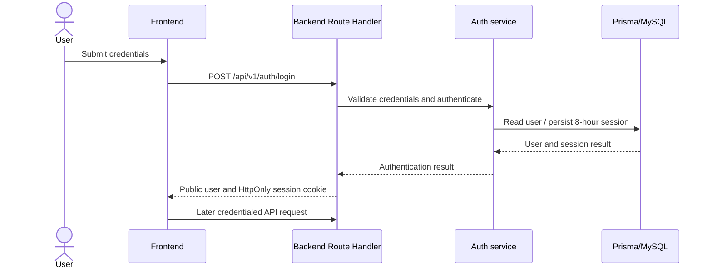

# Authentication flow

## Implemented flow

Login, logout, and current-user routes use the existing session model and cookie name. MFA and
password reset are not implemented; see [authentication security](../security/authentication-security.md).

Logout invalidates the session row; `/auth/me` validates the cookie and returns the current public
user. The server-side admin layout calls `/auth/me` before rendering protected pages. Origin
checks and SameSite cookies are implemented, but a full CSRF-token strategy and login throttling
remain pending. See [assumptions](../assumptions.md) and
[session security](../security/session-security.md).
