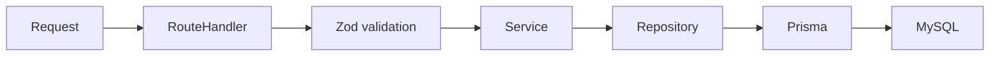

# Backend architecture

The backend is an independent Next.js App Router application in `backend/`. API Route Handlers
belong below `backend/src/app/api/v1/`. `GET /api/v1/health`, User Management, and Authentication endpoints are implemented.

## Current implementation

- The health Route Handler executes `SELECT 1` using the Prisma client and returns 200 or 503.
- Prisma client setup is in `backend/src/lib/prisma.ts`; the schema and seed are in
  `backend/prisma/`.
- The User Management reference demonstrates request-body Zod validation, session lookup,
  role-based authorization, and error mapping.
- User Management service logic lives in `server/services/`; its Prisma queries live in
  `server/repositories/`. Route Handlers delegate to these layers.
- Authentication verifies the existing scrypt password hashes and issues eight-hour sessions
  using the existing Prisma models. MFA, password reset, and email delivery are not implemented.
- `handleApiError` is used by User Management, but is not a global error boundary and is not used
  by the health handler.

## Target for future business routes

User Management implements this boundary as a developer reference; other feature APIs remain
pending. See [API status](../api/api-overview.md) and [security status](../security/README.md).
