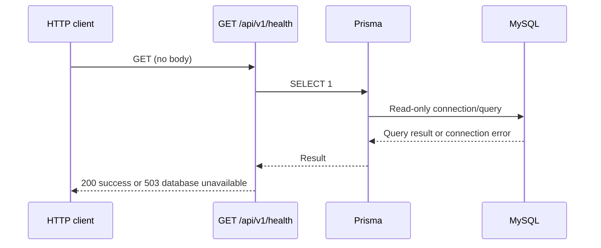

# Data flow

## Health-check flow

The health endpoint bypasses the service/repository layers and makes a read-only Prisma query
directly from the Route Handler.

## User Management flow

The frontend User Management feature calls the separate backend over HTTP with
`credentials: "include"`. Its Route Handlers validate the `campus360_session` cookie and role,
validate inputs, delegate business rules to the service, and send Prisma work through the
repository. This does not issue sessions or implement the rest of the login flow.

See [API overview](../api/api-overview.md).

## Target business-data flow

Future validated business requests are expected to follow Route Handler → Zod validation → service
→ repository → Prisma → MySQL. User Management demonstrates this pattern; other features remain
pending. Returned data should be mapped to an API response before it reaches the browser. See
[backend architecture](./backend-architecture.md).
