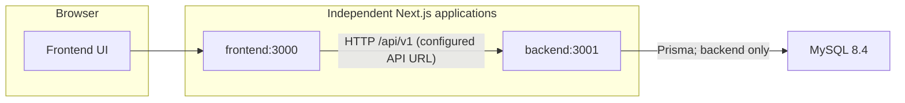

# System architecture

Campus360 is an npm-workspace repository containing two Next.js App Router applications. The
frontend is a React UI; the backend hosts versioned Route Handlers and owns Prisma/MySQL access.
The frontend root page demonstrates the User Management reference feature and uses a shared HTTP
API helper. The backend implements a database-checked health endpoint and the User Management API.

In local development, the applications use separate ports and CORS is configured by the backend
Next.js config. The approved deployment assumption is a single reverse proxy and same-origin public
access; no reverse-proxy configuration is present in this repository. Details are in
[assumptions](../assumptions.md).

The User Management API demonstrates Route Handler → validation → service → repository → Prisma →
MySQL. Other business APIs remain pending; see the [backend architecture](./backend-architecture.md).

## Runtime configuration

The root `package.json` defines workspaces `frontend` and `backend`. The app manifests hold their
own scripts and dependencies. Docker Compose defines MySQL 8.4 with a persistent volume and
separate frontend/backend services. See [development setup](../development/getting-started.md).
